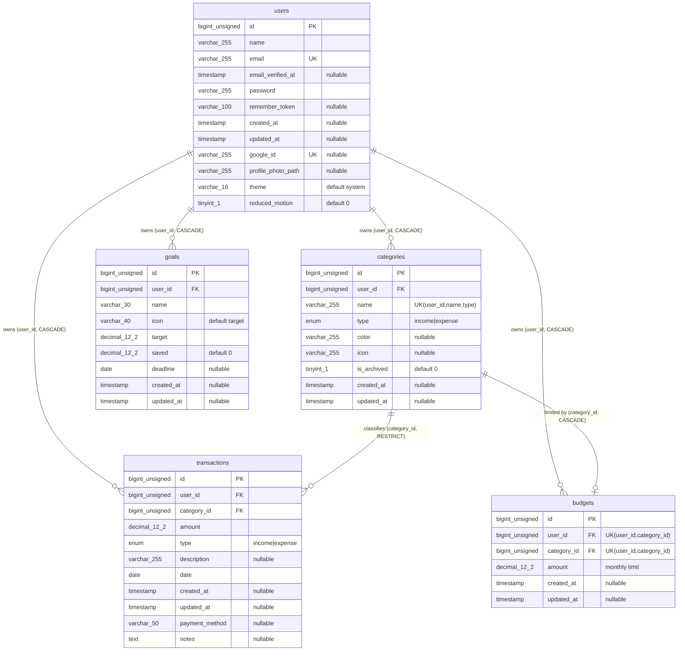
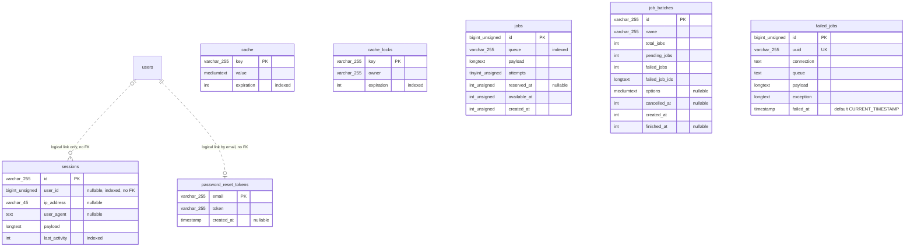

# SpendWise Entity Relationship Diagram

The diagram is written in Mermaid and renders on GitHub and in VS Code with Mermaid Markdown preview support. The same source is stored in [spendwise-erd.mmd](./spendwise-erd.mmd).

Data types follow the Laravel schema builder's MySQL mapping (for example `foreignId` becomes `BIGINT UNSIGNED`). Mermaid attribute types cannot contain parentheses, so `varchar_255` means `VARCHAR(255)`. Column details are in the [data dictionary](./data-dictionary.md).

## Notation

| Symbol | Meaning |
|---|---|
| `\|\|` | exactly one (mandatory) |
| `\|o` | zero or one (optional) |
| `o{` | zero or many |
| solid line | enforced by a database foreign key |
| dotted line | logical relationship only, with no foreign key constraint |

## Core domain (enforced by foreign keys)

## Infrastructure tables and logical links

`cache`, `cache_locks`, `jobs`, `job_batches` and `failed_jobs` have no relationships to the domain tables. In the first diagram the `users` entity is repeated on purpose, and in the second the `users` link is drawn without repeating its columns.

## Reading the diagram

- **User to everything:** a user is the root owner. Deleting a user cascades to categories, transactions, budgets and goals.
- **Transactions and categories:** every transaction must have a category (mandatory), and a category with transactions cannot be deleted at the database level (`RESTRICT`).
- **Budgets:** the unique key `(user_id, category_id)` limits a category to at most one budget, so from the category side the relationship is `0..1`.
- **Goals:** `goals` is related only to `users`. It is deliberately not linked to `transactions`.
- **No many-to-many relationships and no pivot tables** exist in this schema. SpendWise has no tables for AI conversations, savings contributions or tags.
