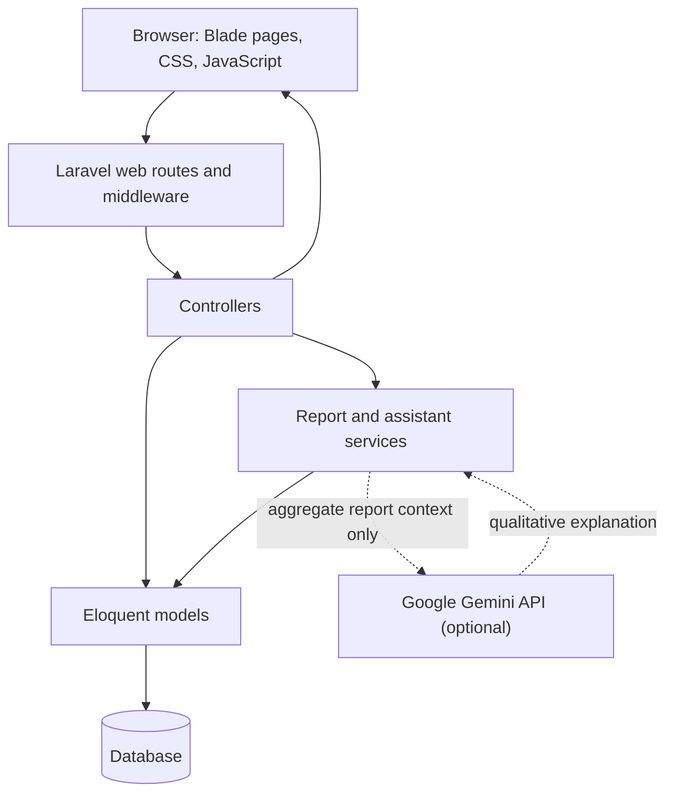
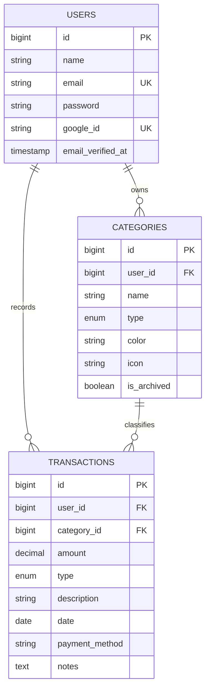

# SpendWise System Architecture and User Flows

## Overview

SpendWise is a Laravel web application for recording personal income and expenses, organizing transactions into user-owned categories, and reviewing financial summaries. Its primary interface is rendered with Blade. Authenticated requests are handled by Laravel routes and controllers, which use Eloquent models to read and update the database.

The Reports page also includes SpendWise AI. Financial totals are calculated by the application from the signed-in user's transactions. Gemini provides general conversation and interprets bounded, server-calculated financial aggregates when configured.

## Architecture



### Responsibilities

| Layer | Responsibility |
|---|---|
| Routes (`routes/web.php`, `routes/auth.php`) | Map URLs to controllers and apply guest, authentication, verification, and rate-limit middleware. |
| Controllers (`app/Http/Controllers/`) | Validate incoming requests, use the authenticated user, coordinate model/service work, and return a Blade view or JSON response. |
| Models (`app/Models/`) | Represent users, categories, and transactions and define their Eloquent relationships. |
| Services (`app/Services/`) | Calculate report data and produce grounded assistant responses; isolate the optional Gemini API call. |
| Blade views (`resources/views/`) | Render the shared application layout and feature interfaces from controller-provided data. |
| Migrations (`database/migrations/`) | Define the relational schema, foreign keys, and database constraints. |
| Vite assets (`resources/js/`, `resources/css/`) | Bundle the shared JavaScript and CSS assets for the Laravel application. |

The shared authenticated layout is `resources/views/layouts/app.blade.php`. It provides the sidebar, header, responsive navigation, page shell, and shared design tokens. Feature pages such as the dashboard, transactions, and reports extend this layout.

## Data Model



- A user has many categories and transactions.
- A category belongs to a user and has many transactions.
- A transaction belongs to a user and category.
- Transaction types and category types are `income` or `expense`.
- Transaction amounts are stored as decimal values. The type identifies whether the amount contributes to income or expenses.
- Foreign keys enforce ownership relationships at the database level. Controllers also scope reads and writes to the authenticated user and validate that a transaction's category belongs to that user and has a matching type.

**Current scope:** The repository has no budget table, Budget model, or budget controller/route. The sidebar can display a Budgets item, but budget tracking and budget-based advice are not implemented. The assistant explicitly says it cannot assess a budget without saved budget records.

## Main Request Flow

1. The browser sends a page request or form submission to Laravel.
2. Laravel matches the URL and method to a route.
3. Middleware checks whether the request is from a guest, an authenticated user, or (for the dashboard) a verified user.
4. The controller validates input and uses the authenticated user's relationships to access their data.
5. Eloquent reads or writes the database. Feature services handle reusable report calculations or assistant behavior.
6. The controller returns a Blade view for a page or JSON for an API-style interaction.
7. Blade renders the response in the shared application layout.

## Authentication and Account Flows

### Registration and login

The registration and login routes use Laravel's authentication controllers from `routes/auth.php`. Custom guest routes for registration/login are also declared in `routes/web.php`; consult `php artisan route:list` when checking which route action is active. Successful authentication regenerates the session. Logout invalidates the session and regenerates the CSRF token.

### Google sign-in

1. A guest visits the Google redirect route.
2. Laravel Socialite redirects the browser to Google.
3. The callback validates the returned Google identity and requires a verified email.
4. The application finds or creates the matching user and associates the Google ID.
5. The user is authenticated, the session is regenerated, and the browser returns to the intended destination or dashboard.

### Password recovery

Laravel's standard password reset routes coexist with SpendWise's email-code flow:

1. A guest requests a reset code for an email address.
2. If the account exists, the application creates a random six-digit code, stores only its hash in cache with a ten-minute lifetime, and emails the code.
3. The user submits the code. Failed attempts are counted and limited; successful verification clears the code and marks the session as verified.
4. The user submits and confirms a new password.
5. The password is hashed and saved, then the user is redirected to login.

The send, verify, and resend endpoints have route-level throttles. Code responses do not disclose whether an email address belongs to an account.

## Finance Feature Flows

### Dashboard

`GET /dashboard` is protected by authentication and email-verification middleware. `DashboardController` calculates all-time balance and current-month income and expenses for the signed-in user, groups their current-month expenses by category, and loads their five latest transactions. It passes those values to `resources/views/dashboard.blade.php`, which renders the summary cards, spending views, and recent activity.

### Categories

The authenticated category resource routes expose JSON list, create, update, and delete operations. Category creation validates the category type and prevents duplicate names for the same user and type. Update and delete operations verify category ownership. The database prevents deleting a category that is still referenced by a transaction.

### Transactions

- `GET /transactions/page` loads the signed-in user's transactions and related categories for the Blade page.
- `GET /transactions` returns the user's transactions as JSON.
- `POST /transactions` validates amount, type, date, and category ownership, then checks that the category type matches the transaction type before creating the record.
- `PUT/PATCH /transactions/{transaction}` and `DELETE /transactions/{transaction}` check that the transaction belongs to the signed-in user.
- The transaction page renders the Add Transaction form and validates its submissions through the transaction endpoint.

### Reports

1. The user visits `GET /reports`, optionally providing `start_date` and `end_date`.
2. `ReportController` validates the date format and ordering. If dates are omitted, the range defaults to the current date and the five months before it.
3. `ReportDataService` queries transactions through the authenticated user's relationship and applies the same date range to totals, category summaries, monthly series, and recent transactions.
4. The controller passes the calculated data to `resources/views/reports/index.blade.php`.
5. The page renders summary cards, income/expense comparisons, category breakdowns, monthly trends, top categories, and recent transactions. Empty ranges display explicit empty states.

### SpendWise AI

1. The browser submits the user's question and the selected date range to `POST /reports/assistant`.
2. The route requires authentication and limits requests to 30 per minute.
3. The controller validates the question and dates, then calls the same report-data service used by the Reports page.
4. `SpendWiseAssistant` selects user-owned aggregate financial context only when the question needs it. Conversation history is kept in the authenticated user's server-side session.
5. When `GEMINI_API_KEY` is configured, `GeminiReportResponder` sends the question and limited totals/category/month aggregates to Gemini. It does not send transaction descriptions or the account name.
6. Responses are checked for valid text and unsupported numeric financial claims; text Gemini returns at its output-token limit can still be used if valid.
7. Missing configuration and provider failures are reported to the user rather than replaced with fabricated answers.

Configure Gemini with `GEMINI_API_KEY`, `GEMINI_MODEL`, and (if needed) `GEMINI_API_ENDPOINT` in the server environment. The endpoint defaults to Google's Gemini API. Never commit the API key.

## Routes at a Glance

| Method | URI | Name | Access | Purpose |
|---|---|---|---|---|
| GET | `/` | — | Public | Landing page |
| GET | `/dashboard` | `dashboard` | Authenticated and verified | Financial overview |
| GET | `/categories` | `categories.index` | Authenticated | List the user's categories as JSON |
| POST | `/categories` | `categories.store` | Authenticated | Create a category |
| PUT/PATCH | `/categories/{category}` | `categories.update` | Authenticated | Update an owned category |
| DELETE | `/categories/{category}` | `categories.destroy` | Authenticated | Delete an owned category |
| GET | `/transactions/page` | `transactions.page` | Authenticated | Transaction Blade page |
| GET | `/transactions` | `transactions.index` | Authenticated | List the user's transactions as JSON |
| POST | `/transactions` | `transactions.store` | Authenticated | Create a validated transaction |
| PUT/PATCH | `/transactions/{transaction}` | `transactions.update` | Authenticated | Update an owned transaction |
| DELETE | `/transactions/{transaction}` | `transactions.destroy` | Authenticated | Delete an owned transaction |
| GET | `/reports` | `reports.index` | Authenticated | Render filtered financial reports |
| POST | `/reports/assistant` | `reports.assistant` | Authenticated, rate-limited | Return a grounded assistant response |
| GET/PATCH/DELETE | `/profile` | `profile.*` | Authenticated | Manage the signed-in user's profile |

The full route list, including auth routes, is available with:

```bash
php artisan route:list
```

## Privacy and Trust Boundaries

- Personal financial queries must remain scoped to the authenticated user's relationships or explicitly filtered by that user's ID.
- User-supplied category and transaction IDs are validated against the current user's records; ownership is not inferred from hidden browser fields.
- Gemini credentials are read from server-side Laravel configuration and are never exposed to the browser.
- Only the selected-range aggregate report summary and the user's question are sent to Gemini. Transaction descriptions and account identity are excluded.
- The database remains authoritative for all financial amounts. Do not present an AI-generated estimate as a recorded transaction total.
- AI output is untrusted. Invalid or ungrounded Gemini responses are not included in the answer.
- Conversation history is scoped by authenticated user and stored in the server-side session; it is not stored in the application database.
- There is no persisted budget functionality in the current schema; do not describe budget evaluation as an implemented capability.

## Tests

Feature tests live in `tests/Feature/`. Relevant suites include:

- `DashboardTest`: dashboard calculations, user isolation, and rendering.
- `TransactionsPageTest`: transaction page behavior, validation, and API responses.
- `ReportsTest`: selected-range calculations, user isolation, empty states, assistant behavior, Gemini request privacy, numeric-output rejection, and API error handling.

Run focused suites with:

```bash
php artisan test tests/Feature/ReportsTest.php tests/Feature/DashboardTest.php
```

Inspect the current migration files and routes when this wiki conflicts with the code; the implementation is the source of truth.
